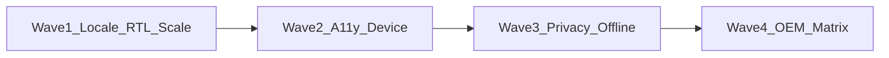

# PixiJoy global readiness — applicable now

Scope: **studio product as shipped** (Home / Studio / Library, on-device photo + movie edit/export, optional ML pack download).  
Out of scope for this plan: currency UI, phone numbers, maps/units, in-app IAP storefront polish (until Pro ships), cultural AI chat.

Status key: **Done** · **Partial** · **Gap**

---

## Priority waves

---

## Wave 1 — Languages, RTL, fonts, UI scaling

**Locked locale set (21, CapCut App Store parity + Lightroom DE/HI):**

| Code | Language | Notes |
|------|----------|--------|
| `values` | English | Default |
| `values-es` | Spanish | |
| `values-pt-rBR` | Portuguese (Brazil) | |
| `values-fr` | French | |
| `values-de` | German | Lightroom |
| `values-it` | Italian | |
| `values-in` | Indonesian | Android code `in` |
| `values-hi` | Hindi | Lightroom |
| `values-ar` | Arabic | RTL |
| `values-iw` | Hebrew | RTL (`iw` on Android) |
| `values-ur` | Urdu | RTL |
| `values-ja` | Japanese | |
| `values-ko` | Korean | |
| `values-zh-rCN` | Chinese (Simplified) | |
| `values-zh-rTW` | Chinese (Traditional) | |
| `values-th` | Thai | |
| `values-vi` | Vietnamese | |
| `values-tr` | Turkish | |
| `values-ru` | Russian | |
| `values-pl` | Polish | |
| `values-fil` | Filipino | |
| `values-ms` | Malay | |
| `values-uk` | Ukrainian | |

That is **22 locales including English** (≥20). Expand later only with install data.

| Item | Status | Work |
|------|--------|------|
| Languages | **Done (machine-assisted)** | 22 non-EN `values-*/strings.xml` + plurals (433 keys each) via `tools/i18n_cache` → `emit_locale_xml.py`. Device language follow (no in-app picker for v1). Professional review before store. |
| RTL | **Partial** | `pj_ic_back` / undo / redo `autoMirrored`; audit glass rail + scrub + export chevrons; Maestro `ar` smoke still open. |
| Fonts | **Partial** | Noto downloadable + SansSerif DS. Verify CJK/Arabic/Devanagari/Hebrew in chrome + titles. |
| UI scaling | **Done (code + flow)** | `studioGlassMaxDp` scales with `fontScale`. Maestro `.maestro/chrome/fontscale-studio.yaml` (host sets `font_scale 1.3`). |
| Numbers (user-facing) | **Partial** | Locale formats for relative time / typed values where user-facing. |

**Exit:** All locked locales present; RTL smoke on `ar`; fontScale 1.3 on Pixel_7a.

---

## Wave 2 — Accessibility + form factors (already started)

| Item | Status | Work |
|------|--------|------|
| Accessibility | **Done (a11y-tree)** | G4 chrome + Maestro `.maestro/chrome/talkback-studio.yaml` green. System TalkBack-on remains optional checklist in `.maestro/YELLOW-talkback-studio.md`. |
| Large text / contrast | **Done** | `studioGlassMaxDp(height, fontScale)` grows glass under 1.3–1.5×. Maestro `.maestro/chrome/fontscale-studio.yaml` **green** Pixel_7a. White on frosted glass. |
| Screen sizes | **Done** | Hub `isStudioTwoPane` (tablet); session `isStudioSessionSideTools` (tablet + wide phone landscape). Maestro tablet-side-tools **green** Pixel_Tablet. |
| Orientation | **Done** | Landscape phone = full-bleed session + side tools. Maestro landscape-phone-session (host `user_rotation 1`). Create sheet densifies + promotes Sample when height &lt; 560. |
| Multi-window | **Done (sim)** | Unit gate + Maestro multiwindow-narrow **green** (`wm size 1080x1600`). Manual OS split-screen still optional. |

**Exit:** TalkBack a11y-tree green; fontScale 1.3 smoke; multi-window narrow stays single-pane; tablet side-tools still green.

---

## Wave 3 — Privacy, legal, offline, network, notifications

| Item | Status | Work |
|------|--------|------|
| Privacy / consent | **Done** | First-run `StudioPrivacy` opens the in-app privacy policy and terms (`privacy_policy_link` / `privacy_terms_link`). Library footer repeats them. No website. |
| Delete-all / reset | **Done** | Library **Delete all projects** + **Reset app data** (clears prefs → Privacy gate). `ProjectRepository.deleteAll()`. |
| Offline | **Done** | Pack empty copy: “Download an on-device model pack. Edits never leave this phone.” Existing Missing/Installing/Ready copy stays on-device. |
| Network | **Done** | Pack HTTPS+SHA + Retry already; no pack spinner on session open. |
| Notifications | **Done** | `ExportNotifications` uses localized `studio_export` / `studio_export_pct` / `studio_exporting`. `rememberExportNotificationGate` requests `POST_NOTIFICATIONS` only on export start (API 33+). |
| Legal | **Partial** | Terms + Privacy in app. Play Data safety / age rating remain store-console (Wave 4). |
| Security | **Partial** | Local projects; privacy flag in DataStore; `allowBackup=false`. Encrypted prefs deferred. |

**Exit:** Privacy/Terms links in app; delete-all/reset; pack offline messaging reviewed; export notif localized. **MET.**

---

## Wave 4 — Devices, OEM, performance, store

| Item | Status | Work |
|------|--------|------|
| Android versions | **Partial** | minSdk 31 / target 35. Lab AVDs API 35+37. Physical API 31/34 smoke still ☐ in [DEVICE_MATRIX.md](DEVICE_MATRIX.md). |
| Performance | **Partial** | WorkManager export + release ABI filters. Low-RAM timeouts remain opportunistic. |
| Battery / OEM | **Done (docs)** | [OEM_EXPORT.md](OEM_EXPORT.md) — Samsung/Xiaomi steps; `export_leave_safe` on photo + movie sheets. |
| OEMs | **Partial** | Matrix table + manual Pixel/Samsung/Xiaomi checklist in [DEVICE_MATRIX.md](DEVICE_MATRIX.md). Automated Pixel AVD/Tablet **green** 2026-09-26. |
| App stores | **Done (checklist)** | [PLAY_LISTING_CHECKLIST.md](PLAY_LISTING_CHECKLIST.md) — Data safety + listing + pre-upload. |
| Testing matrix | **Partial** | Locale/RTL/fontScale/tablet/landscape/privacy Maestro green on Pixel lab. Offline pack still device-net. |
| Support | **Done** | `studio_export_failed_help` + `studio_pack_failed_help` surfaced on failure. |

**Exit:** Written device matrix with last-pass dates; Play listing checklist; export-on-OEM note in docs. **MET (lab + docs).** Physical OEM lab boxes remain for pre-Play.

---

## Deferred (applicable later, not now)

- **Payments** — `billing/OneTimeStore` exists; full Play Billing + tax UI when Pro/credits ship.
- **Analytics** — only with privacy-compliant design; do not contradict on-device promise.
- **AI regional models / cultural responses** — when generative/board AI ships.
- **Currency / phone / maps / °C·km** — N/A for studio core.

---

## Suggested delivery slices

1. **GR-1** — `docs/GLOBAL_READINESS.md` (this doc) + launch locale list decision  
2. **GR-2** — First locale pack + RTL chrome fixes + fontScale smoke  
3. **GR-3** — TalkBack device green + adaptive regression  
4. **GR-4** — Privacy/Terms/delete-all + pack offline copy  
5. **GR-5** — OEM/API matrix + Play listing / notif localization  

Each slice: assembleDebug → Maestro (or manual) on Pixel_7a → update status in this file.

---

## Explicit non-goals this quarter

- Human-reviewed store-quality translation for all 22 locales in one pass (machine-assisted ship first; professional review per launch market)
- In-app language picker (follow device locale for v1)
- Currency / regional tax UI before Pro billing 
- Custom local payment methods beyond Play  
- Maps, contacts, weather units  
- Redesigning IA for RTL (mirror existing CapCut-style chrome, don’t invent a new shell)
