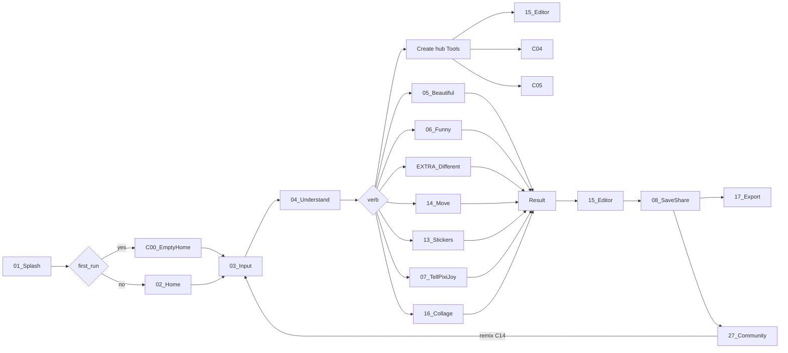

# PixiJoy navigation (Cursor source of truth)

Read this before changing routes, tabs, or create entry points.

## IA lock

Root destinations only (chrome labels):

`Home | Explore | Create | Community | My Stuff`

Route ids still use Discover / Profile in code (`tab_discover`, `b2_discover`, `b18_browse`). Do not rename the bar.

- Creations is **not** a tab. It lives at My Stuff → Creations and as a Home row.
- Flow 1 onboarding mock (Home / Explore / Creations / Profile) is **obsolete**.
- Flow 12 tab set wins when boards disagree.

Compact / fold cover: bottom bar, Create in the center.  
≥840dp (tablet landscape, fold inner): nav rail + canvas pane. Sheets become side panes.

## Spine

Overlays (must pop and return to the same control): `credits`, `pro_lock`, `guest_wall`, `safety`, `offline`, `recovery`.

## Create graph

Create tab root: `b_create_hub`. Segmented control **Tools** (default) | **AI**.

### Tools

| Tile | Route id |
|---|---|
| Add photo | pipeline.openMediaInput |
| Editor | b15_open |
| Restore | b_c05 |
| Expand | b_c10 |
| Remove BG | b_c04 |
| Stickers | pipeline.openStickers |
| People | b_c08 |
| Scene | b_c07 |
| Move (3-layer Reels) | pipeline.openMove → b14_input |
| Talking photo | b_c11 |
| Slideshow | b14_input |
| Video → GIF | b3_video |
| Collage | pipeline.openCollage |
| Greeting | b_c12 |
| Portrait | b_c09 |
| Remix | b_c14 |
| Export (incl. 4×6 / A4 print) | pipeline.openExport |

### AI

| Tile | Route id |
|---|---|
| Beautiful | pipeline.openBeautiful (05) |
| Funny | pipeline.openFunny (06) / CREATE_HUB_MEME |
| Different | pipeline.openDifferent |
| Tell PixiJoy | pipeline.openTell (07) |

Credits / Gemini honesty belong on the AI segment only.

Result footer on every generate: Save · Share · Edit · Export · Remake · Publish.
